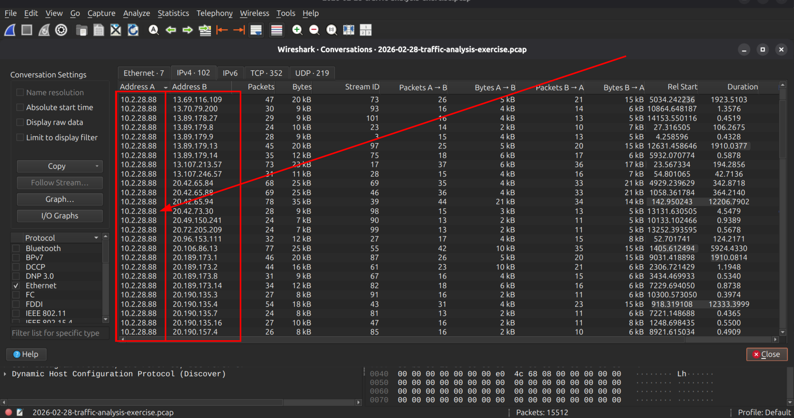
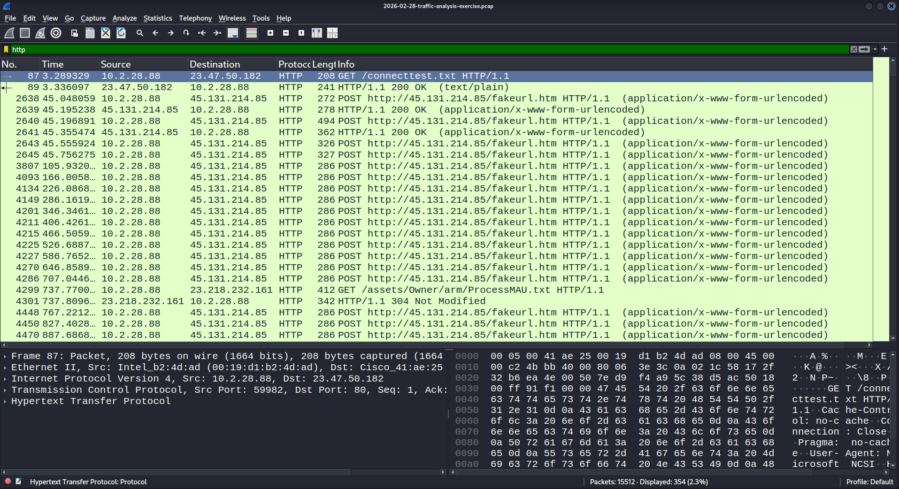
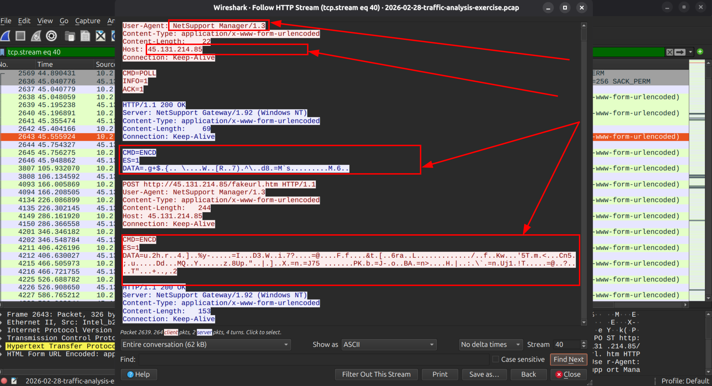
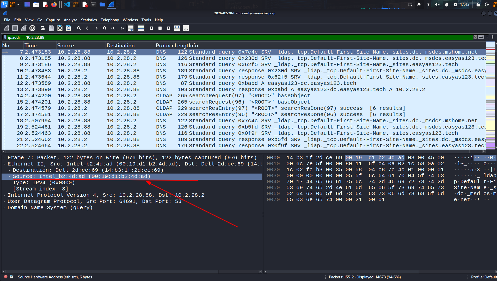
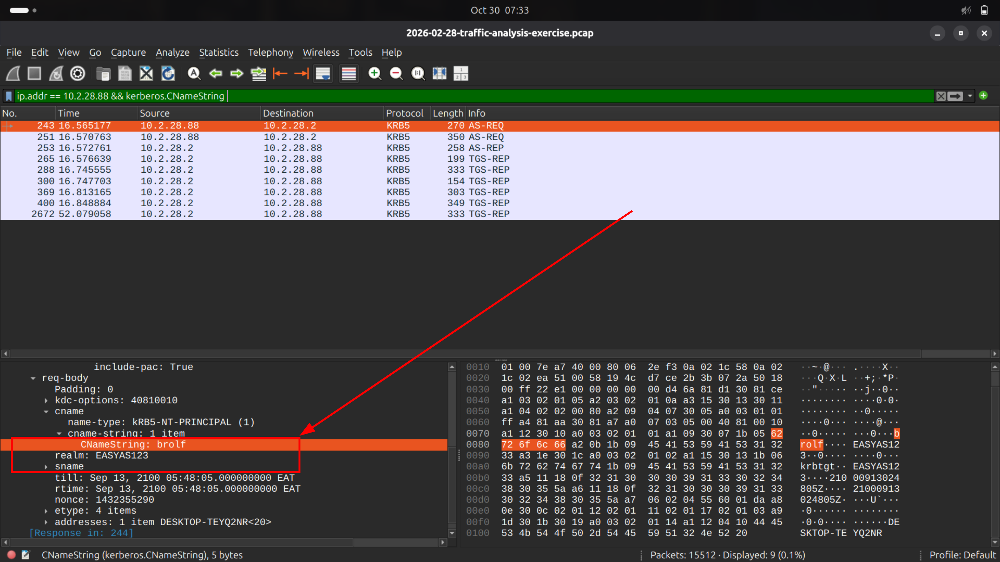
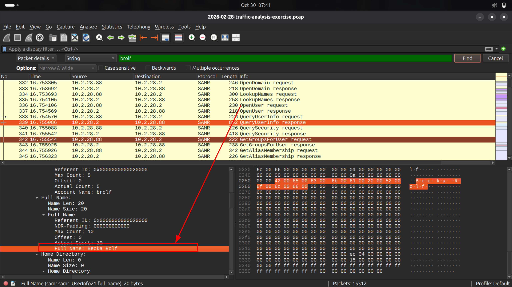

# Source of PCAP:

Malware-Traffic-Analysis.net

# File Name:

 2026-02-28 EASY as 123

# Zip file password:
infected_20260228

# SCENARIO
- LAN Segment range:
    10.2.28.0/24
    (10.2.28.0 - 10.2.28.255)

- Domain:
    easy123.tech

- Domain Controller:
    EASYAS-DC

- AD Environment Name:
    EASYAS123

- LAN Segment gateway:
    10.2.28.1

- LAN segment broadcast address:
    10.2.28.255

- Malware Source:
    45.131.214.85

- TCP port:
    443

- Infection Time:

## EXECUTIVE SUMMARY

A windows system with  user account Brolf was infected with  a netsupport malware.The full username is Becka brolf and Mac address is 00:19:d1:b2:4d:ad.

#   OBJECTIVES

Malware Name:NetSupport Manager RAT

1. The IP of the infected Windows client:
    *10.2.28.88*

2. The MAC address of the infected windows client:
    *00:19:d1:b2:4d:ad*

3. The user account name of the infected windows client:
    *brolf*

4. The full name of the user from the infected windows user account:
    *Becka Rolf*

# ANALYSIS

- Infected  windows Client

From the conversations tab we can identify that a host by the ip "10.2.28.88" is making alot of traffic with external ips:

To identify the IP of the infected windows client we filter  for http traffic (unencrypted traffic) and what the contents of the traffic are:

It seems there is alot of traffic comming from  10.2.28.88

Checking the type of trafficu coming from it we see its sending some POST request to "hxxp[:]45.131.214.85/fakeurl[.]htm" which could be possible data leaks

Filter:
ip.addr==10.2.28.88 && http.request.method == "POST"

Above we can identify the user agent to be "NetSupport Manager/1.3" which is used for Network Administration.

There are also some commands sent along illustrated in the CMD and also  encoded data in DATA.

**IP: 10.2.28.88**

- MAC Address of the infected windows host

Now that we have the IP of the Infected Windows Host,we need to identify its Mac address which we do so by filtering with its ip address "ip.addr == 10.2.28.88 "

**Mac addr: 00:19:d1:b2:4d:ad**

- User Account Name

To identify the user account name we need to user Kerberos traffic to identify any username  used for ticket granting,we use the filter "kerberos.CNameString"

Kerberos Traffic

We idetify the CNameString as "brolf" which our client user's account name

 **User account name: brolf**

- Full Username of the user

To obtain the full name of the user we need to use the search function "Ctrl + C" and  set options to "String and packet details".

**Full Username: Becka Rolf**
